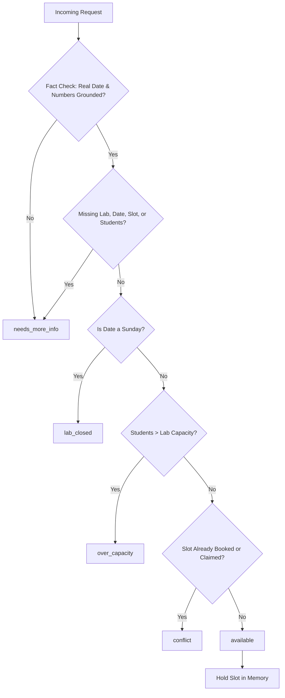

# Lab Booking Request Sorter 🎓

**Course:** CIT AI-Native Engineering Programme · Semester 1 · Assessment 5 (Capstone Project)  
**Author:** Student  
**AI LLM Engine:** Groq Cloud API (`llama-3.3-70b-versatile` / `llama-3.1-8b-instant`)

---

## 1. Project Overview

The **Lab Booking Request Sorter** is a console-based Python tool designed to streamline campus laboratory reservation requests. Faculty and student organizers submit room requests in unstructured conversational English (e.g., *"Need Python Lab 1 on 15 October afternoon for 55 students"*). 

This tool:
1. Uses a Large Language Model via the **Groq API** to extract structured scheduling parameters (`lab`, `date`, `slot`, `students`, `summary`).
2. Applies strict **Python business logic** to validate calendar dates, enforce capacity constraints, check Sunday closures, and prevent booking collisions.
3. Automatically outputs a **tentative schedule** and an **issues report**.

> **CRITICAL HUMAN-IN-THE-LOOP PRINCIPLE:**  
> The software **NEVER** books or modifies laboratory records automatically. All final booking confirmations must be approved by the **Lab In-Charge**.

---

## 2. Project File Structure

```text
lab_booking_sorter/
│
├── main.py                     # Main console application
├── test_project.py             # Evaluation harness (5 unit tests + 3 red-team tests)
├── system_prompt.txt           # 5-role LLM prompt (Authority, Exemplar, Constraint, Rubric, Metadata)
│
├── requests.csv                # Input: 20 realistic booking requests
├── labs.csv                    # Input: Master lab list with capacities
├── bookings.csv                # Input: Confirmed master register (read-only)
│
├── results.csv                 # Output: Full status audit log
├── schedule.csv                # Output: Sorted tentative schedule for available requests
├── issues.csv                  # Output: Unbookable requests with reasons
├── summary.txt                 # Output: Counts by status and lab
│
├── specification.md            # One-page project specification
├── judgment_framework.md       # Risk matrix & human checkpoint documentation
├── cost_latency.md             # Token usage, latency & cost calculations (Groq API)
├── eval_results.md             # Harness unit test & red-team vulnerability analysis
├── ai_decision_journal.md      # Decisions made while building with AI
├── reflection.md               # 400-word personal project reflection
│
├── requirements.txt            # Python dependencies (groq, python-dotenv)
├── .env.example                # Template for environment variables
└── .gitignore                  # Keeps secrets (.env) and cache out of Git
```

---

## 3. Setup and Installation

### Step 1: Install Dependencies
Open PowerShell or your command prompt in this directory and run:
```bash
pip install -r requirements.txt
```

### Step 2: Configure Environment Variables
1. Copy `.env.example` to `.env`:
   ```bash
   cp .env.example .env
   ```
2. Open `.env` and insert your **Groq API Key**:
   ```env
   GROQ_API_KEY=gsk_your_actual_groq_api_key_here
   SEMESTER_START=2026-10-01
   SEMESTER_END=2026-12-15
   ```
   *(Get your free Groq key at [https://console.groq.com/keys](https://console.groq.com/keys))*.

---

## 4. Running the Program

Run the main sorter application:
```bash
python main.py
```

### Running the Test Suite (Evaluation Harness & Red-Team Tests)
To run the automated tests and verify 100% decision accuracy:
```bash
python test_project.py
```

---

## 5. Status Decision Rules (Strict Order of Precedence)

Python evaluates statuses in the following non-negotiable order:



1. **Fact Check:** Real calendar date (`datetime`), within semester, day & student count grounded in original text.
2. **`needs_more_info`:** Missing or ambiguous lab, date, slot, or student headcount.
3. **`lab_closed`:** Requested date falls on Sunday.
4. **`over_capacity`:** Student count exceeds lab room capacity.
5. **`conflict`:** Requested slot is already occupied in `bookings.csv` or by an earlier accepted request.
6. **`available`:** All requirements met; slot is tentatively reserved.

---

## 6. Git and GitHub Submission Instructions

Follow these exact steps in your terminal to initialize Git and upload to your GitHub repository:

### 1. Initialize Repository
```bash
cd "C:\Users\Admin\Desktop\lab_booking_sorter"
git init
```

### 2. Check Git Status (Verify `.env` is ignored)
```bash
git status
```
*(Make sure `.env` does NOT show up! The `.gitignore` file keeps your API key safe).*

### 3. Create at least 3 Meaningful Commits
```bash
# Commit 1: Project specification and initial input datasets
git add specification.md labs.csv bookings.csv requests.csv .gitignore
git commit -m "feat: add project specification and input CSV files"

# Commit 2: Main application and prompt configuration
git add system_prompt.txt main.py requirements.txt .env.example
git commit -m "feat: implement Groq LLM extraction and Python decision engine"

# Commit 3: Output reports, tests, and documentation
git add test_project.py results.csv schedule.csv issues.csv summary.txt judgment_framework.md cost_latency.md eval_results.md ai_decision_journal.md reflection.md README.md
git commit -m "docs: complete evaluation harness, reports, and submission documents"
```

### 4. Push to Your GitHub Account
Create a new public or private repository on [https://github.com/new](https://github.com/new) named `lab-booking-sorter`, then run:
```bash
git remote add origin https://github.com/<your-username>/lab-booking-sorter.git
git branch -M main
git push -u origin main
```
